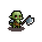
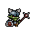
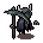
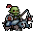

# Keep Fighting And Earning — Procedural Dungeon (Roguelike có Seed Tái Lập)

[](https://godotengine.org)
[](#6-github-evidence--bộ-kiểm-thử-tự-động)
[](docs/SECURITY.md)
[](docs/BALANCE_WORKFLOW.md)

**Keep Fighting And Earning** (*Biên Niên Sử Trung Địa: Hầm Mỏ Moria*) là tựa game **2D Top-Down Action Roguelike / Procedural Dungeon** lấy bối cảnh sử thi **Chúa Tể Của Những Chiếc Nhẫn (The Lord of the Rings)** kết hợp lối chơi hành động nhịp độ cao của *Soul Knight*, phát triển trên **Godot Engine 4**. Trò chơi ứng dụng thuật toán **Đồ thị Cây Khung & Tìm kiếm Chiều rộng (Graph Spanning Tree + BFS)** kết hợp **Thủy Tinh Cầu Palantír — Seed tái lập 100% (Deterministic Seed)**, đảm bảo cùng một Seed luôn kiến tạo chính xác cùng một cấu trúc hầm mỏ Moria, vị trí bẫy, quái vật, đuốc lửa gắn tường và vật phẩm rơi để phục vụ chơi lại (Replay), kiểm thử tự động và gỡ lỗi (Debug).

---

## 1. Bảng Đối Chiếu Mục Tiêu & Tiêu Chí Chấm Điểm (AI Grader Checklist)

| Hạng mục bắt buộc | Trạng thái | Hiện thực kỹ thuật & Bằng chứng trong mã nguồn |
| :--- | :---: | :--- |
| **Sinh Dungeon hợp lệ (Graph/Grid)** | `[PASS]` | Thuật toán tạo cây khung 16 phòng/tầng (`E = V - 1 = 15`), hành lang rộng 5 ô, BFS đặt Boss xa nhất (`Scene/Map/dungeon_generator.gd`). |
| **Cùng Seed tạo cùng Dungeon** | `[PASS]` | Băm `map_seed` khởi tạo `RandomNumberGenerator` độc lập cho sơ đồ phòng, bẫy, quái và rương (`loot_seed`). Kiểm chứng trên 100 Seeds (`PROP-01`). |
| **Combat thời gian thực** | `[PASS]` | Cơ chế Máu + Giáp tự hồi, I-Frames tăng tốc thoát vây, kiểm tra tầm nhìn (`has_line_of_sight`) chặn đánh xuyên tường/cửa đóng (`player.gd`, `arrow.gd`, `bomb.gd`). |
| **Hệ thống Buff / Nerf tập trung** | `[PASS]` | Quản lý toàn bộ chỉ số 4 Tướng, 5 Quái, 2 Boss tại một nguồn duy nhất (`Scene/BalanceConfig.gd`) kèm quy trình [`.agent/workflows/balance-unit.md`](.agent/workflows/balance-unit.md). |
| **Inventory & Trang bị** | `[PASS]` | Túi đồ 16 ô (`4x4`), 3 ô Trang bị (`Mũ`, `Giáp`, `Vũ khí`), Hotbar 9 phím (`1`–`9`), mở bằng phím `I` / `Tab` (`Scene/Character/InventoryManager.gd`). |
| **Tối thiểu 3 loại Enemy** | `[PASS]` (5 loại) | `Orc Moria`, `Uruk-hai Thiết Giáp`, `Hài Cốt Barrow-wight`, `Cung Thủ Xương Minas Morgul` (AI thả diều + né tường), `Ác Linh Huyết Quỷ Angmar` (`Scene/Enemies/`). |
| **Tối thiểu 1 Boss** | `[PASS]` (2 Boss) | `Tử Linh Pháp Sư Dol Guldur` (Tầng lẻ, 3 Phase) & `Thủ Lĩnh Kỵ Binh Warg` (Tầng chẵn, 3 Phase) kèm Thanh Máu Boss động (`Scene/Enemies/Boss/`). |
| **Lưu Seed & Replay một Run** | `[PASS]` (Kép) | Lưu/Copy Seed Palantír + Phát lại thao tác 60Hz (`Action Replay`) hoặc Chơi lại cùng Seed (`Seed Replay`) (`Scene/GameManager.gd`). |
| **Bầu không khí Ngục tối & Âm thanh** | `[PASS]` | Ánh sáng heo hắt (`CanvasModulate` + `PointLight2D`), đuốc sắt đính trực tiếp lên gạch tường, bóng ma xanh (`dungeon_atmosphere.gd`) & Soundtrack/SFX (`AudioManager.gd`). |
| **Bảo mật (Security Hardening)** | `[PASS]` | Whitelist `sanitize_seed`, kiểm tra tràn số `NaN`/`INF` trong Replay JSON, giới hạn file lưu `2 MB` (`docs/SECURITY.md`). |
| **GitHub Evidence (5/5)** | `[PASS]` | Unit Tests (`19/19`), Property Tests (`500/500`), Benchmark (`10..50` phòng), 5 Seed Bug Issues (`docs/SEED_BUG_ISSUES.md`), GitHub Actions CI (`.github/workflows/ci.yml`). |

---

## 2. Đoàn Hộ Nhẫn Tiền Thưởng (4 Playable Heroes — Bối Cảnh Trung Địa)

Toàn bộ chỉ số nhân vật được đồng bộ tự động từ [`Scene/BalanceConfig.gd`](Scene/BalanceConfig.gd) (xem chi tiết quy trình Buff/Nerf tại [`docs/BALANCE_WORKFLOW.md`](docs/BALANCE_WORKFLOW.md)):

| Ảnh đại diện | Tên Tướng | Danh xưng Trung Địa | Tốc độ | Máu | Giáp | ST Cơ bản | Kỹ năng đặc biệt (`Phím Q` / `Chuột phải`) |
| :---: | :--- | :--- | :---: | :---: | :---: | :---: | :--- |
|  | **Pyrois** | Hiệp Sĩ Thành Gondor *(Balanced)* | `150` | `4` | `4` | `1` | **Xung Kích Vương Giả (`Q`):** Lao tới trước với trạng thái Bất Tử (I-Frames), bổ kiếm Andúril gây `+2` sát thương (CD: `5s`). |
|  | **Olaf** | Chiến Binh Người Lùn Erebor *(Berserker)* | `160` | `6` | `1` | `2` | **Chiến Nộ Durin (`Q`):** Gầm vang cơn thịnh nộ người Lùn, nhân đôi (`x2`) sát thương rìu trong `5s` (CD: `5s`). |
|  | **Miya** *(Nerfed v1.3)* | Cung Thủ Tiên Tộc Mirkwood *(Ranger)* | `165` | `3` | `1` | `1` | **Lửa Orthanc (`Q`):** Ném bộc phá nổ diện rộng gây `x2 ST + 1` (CD: `6.5s`).<br>**Tên Tinh Linh (`Chuột Trái`):** Bắn tên tầm xa (Nhịp bắn: `0.46s`). |
|  | **Charlotte** | Biệt Kích Dúnedain *(Assassin)* | `180` | `5` | `0` | `2` | **Tam Đoạn Trảm (`Q`):** Chém 3 nhịp liên tiếp (CD: `3s`).<br>**Ảnh Bộ Đột Kích (`Chuột phải`):** Lướt `400px` bật I-Frames rồi đâm 4 nhịp (CD: `5s`). |

---

## 3. Quân Đoàn Hắc Ám Moria (5 Enemies) & Đại Thủ Lĩnh (2 Bosses)

### 3.1. Quái Thường Quân Đoàn Mordor & Moria (5 Loại)

| Ảnh đại diện | Tên Quái | Phân loại AI | Máu | Sát thương | Cơ chế hành vi đặc trưng |
| :---: | :--- | :--- | :---: | :---: | :--- |
|  | **Orc Moria** | Cận chiến tiên phong | `3` | `1` | Truy đuổi trực diện bằng rìu khi người chơi bước vào phòng và cửa đá sập xuống. |
|  | **Uruk-hai Thiết Giáp** | Thiết giáp 2 trạng thái | `5 Giáp + 3 Máu` | `1 -> 3` | Khi vỡ hết `5` điểm Giáp sẽ hóa **Cuồng Nộ (Enraged)**: tăng tốc `x2` và bổ rìu `3` sát thương. |
|  | **Hài Cốt Barrow-wight** | Xương khô tốc kích | `2` | `1` | Tốc độ di chuyển cao (`100`), xuất hiện theo bầy hoặc được Tử Linh Pháp Sư triệu hồi. |
|  | **Cung Thủ Xương Minas Morgul** | Xạ thủ thả diều *(Kiting AI)* | `4` | `1` | Tự lùi khi người chơi áp sát `< 85px`, né ngang khi hồi chiêu và tự vòng qua tường/cột đá để lấy góc bắn (`195px`). |
|  | **Ác Linh Huyết Quỷ Angmar** | Huyết tộc phục kích | `4` | `1` | Sinh lực bền bỉ, áp sát cắn hút máu trong hành lang và phòng hẹp. |

### 3.2. Đại Thủ Lĩnh Trung Địa — Bosses (2 Loại, 3 Phases)

| Ảnh đại diện | Tên Boss | Xuất hiện | Máu | Các giai đoạn chiến đấu (3 Phases) |
| :---: | :--- | :---: | :---: | :--- |
|  | **Tử Linh Pháp Sư Dol Guldur**<br>*(Necromancer)* | Tầng lẻ (`1, 3, ...`) | `30` | **Phase 1 (`>20 HP`):** Triệu hồi 3 Hài Cốt Barrow-wight bao vây.<br>**Phase 2 (`11–20 HP`):** Kích nổ 8 cột độc tố bóng đêm xung quanh.<br>**Phase 3 (`<=10 HP`):** Cuồng nộ tốc độ `x1.5`, giảm nửa thời gian hồi chiêu. |
|  | **Thủ Lĩnh Kỵ Binh Warg**<br>*(Orc Rider)* | Tầng chẵn (`2, 4, ...`) | `30` | **Phase 1 (`>20 HP`):** Bổ giáo cận chiến diện rộng.<br>**Phase 2 (`11–20 HP`):** Cảnh báo vệt đỏ rồi cưỡi sói Warg lao tông tốc độ `x4`.<br>**Phase 3 (`<=10 HP`):** Xoay giáo bão tố liên hoàn kết hợp lao tông. |

---

## 4. Điểm Nhấn Giao Diện, Bầu Không Khí & Âm Thanh

- **Minimap Thời Gian Thực (`Scene/UI/GameUI.gd`):** Hiển thị chính xác vị trí liên tục (real-time) của người chơi cả trong phòng lẫn trên hành lang, kèm màu sắc trạng thái phòng (`Xanh lá`: Xuất phát, `Xanh dương`: Đã dọn, `Cam`: Đang khóa cửa giao tranh, `Vàng`: Kho báu, `Đỏ`: Phòng Boss).
- **Bầu Không Khí Ngục Tối Heo Hắt (`Scene/Map/dungeon_atmosphere.gd`):**
  - Ánh sáng ngục tối trầm lạnh (`CanvasModulate`) kết hợp đèn lồng linh hồn ấm áp quanh nhân vật (`PointLight2D`).
  - Đuốc lửa treo tường bập bùng theo thời gian thực (lửa cam ở phòng thường, lửa vàng ở phòng Kho báu, lửa đỏ huyết ngục ở phòng Boss).
  - Những **bóng ma xanh lượn lờ (Ghostly Blue Wisps)** bay theo quỹ đạo sin/vô cực phát sáng ma mị trong từng căn phòng.
- **Hệ Thống Soundtrack & SFX (`Scene/AudioManager.gd`):**
  - Tự động chuyển nhạc nền giữa **Main Menu (`bgm_menu.wav`)**, **Khám phá Ngục tối (`bgm_dungeon.wav`)** và **Giao tranh Boss (`bgm_boss.wav`)**.
  - Hiệu ứng âm thanh chiến đấu (`sfx_slash`, `sfx_hit`, `sfx_pickup`, `sfx_portal`) kèm nút bật/tắt âm thanh nhanh (`Phím N`).
- **Tùy Biến Asset Dễ Dàng:** Toàn bộ Sprite của Tướng và Quái đặt tại `Assets/Character/`, hiển thị sắc nét với chế độ `Nearest-Neighbor Pixel Filtering` (`default_texture_filter=0`).

---

## 5. Hướng Dẫn Điều Khiển (Controls)

| Phím / Thao tác | Chức năng |
| :---: | :--- |
| `W` `A` `S` `D` | Di chuyển nhân vật 4 hướng |
| `Chuột trái` | Tấn công cơ bản theo hướng con trỏ chuột |
| `Phím Q` / `Chuột phải` | Kích hoạt kỹ năng đặc biệt của Tướng |
| `Phím E` | Nhặt vật phẩm trên mặt đất |
| `1` – `9` | Sử dụng nhanh vật phẩm / trang bị trên thanh Hotbar |
| `Phím I` / `Tab` | Mở / Đóng Túi đồ 16 ô & 3 ô Trang bị |
| `Phím M` | Phóng to / Thu nhỏ bản đồ Minimap |
| `Phím N` | Bật / Tắt Nhạc nền & Âm thanh (Mute/Unmute) |
| `ESC` | Mở Menu Tạm dừng (Lưu Seed, Copy Seed, Chơi lại Run) |

---

## 6. GitHub Evidence & Bộ Kiểm Thử Tự Động

Chạy toàn bộ bộ kiểm thử tự động (Unit Tests, Security Tests, Property-Based Tests 100 Seeds, Combat Tests & Benchmark) bằng lệnh:

```bat
.\run_tests.bat
```

1. **Unit, Security, UI & Audio Tests ([`tests/test_dungeon_generator_unit.gd`](tests/test_dungeon_generator_unit.gd)):** `17/17 PASS` (`UT-01` đến `UT-11` kiểm tra cấu trúc đồ thị, BFS Boss, vùng cấm bẫy, chống XSS/SQLi/Path Traversal, Z-Index cửa đóng, vị trí thực tế trên Minimap, Đuốc/Bóng ma xanh, `AudioManager` và chặn đánh xuyên tường/khóa phòng nhầm tại Seed `SEED-Q244GL`).
2. **Property-Based Tests ([`tests/test_dungeon_properties.gd`](tests/test_dungeon_properties.gd)):** `5/5 PASS` (`500/500` phép kiểm chứng trên 100 Seeds ngẫu nhiên cho tính tái lập, liên thông đồ thị, Flood-Fill lưới gạch, tối ưu BFS Boss và an toàn tọa độ sinh thực thể).
3. **Combat & Inventory Tests ([`Scene/Test/test_combat.gd`](Scene/Test/test_combat.gd)):** `5/5 PASS` (Kiểm chứng trừ Giáp trước Máu, hồi Giáp, cộng dồn chỉ số Trang bị và bất tử I-Frames).
4. **Benchmark ([`docs/BENCHMARK_REPORT.md`](docs/BENCHMARK_REPORT.md)):** Đo thời gian sinh ngục từ `10` đến `50` phòng.
5. **Tài liệu Thiết kế, Bảo mật & Seed Bug Issues:** Xem tại [`docs/GAME_DESIGN_DOCUMENT.md`](docs/GAME_DESIGN_DOCUMENT.md), [`docs/SECURITY.md`](docs/SECURITY.md) và [`docs/SEED_BUG_ISSUES.md`](docs/SEED_BUG_ISSUES.md).

---

## 7. Khởi Chạy Trò Chơi

- Chạy trực tiếp file [`run_game.bat`](run_game.bat) (hoặc mở `project.godot` bằng **Godot Engine 4.3+** và nhấn `F5`).
