# Keep Fighting And Earning

Keep Fighting And Earning is a 2D top-down action roguelike built with Godot Engine 4.7.2. The project combines deterministic procedural dungeon generation, real-time combat with data-driven unit balancing, an interactive Guild Hall with merchant economies, a 30-perk progression system, 60Hz deterministic replay recording, and an extensive headless automated test suite.

---

## Table of Contents

1. [Project Overview and Tech Stack](#1-project-overview-and-tech-stack)
2. [System Architecture and Core Mechanics](#2-system-architecture-and-core-mechanics)
3. [Playable Character Roster](#3-playable-character-roster)
4. [Enemies and Boss Encounters](#4-enemies-and-boss-encounters)
5. [Project Directory Structure](#5-project-directory-structure)
6. [Automated Test Suite and CI Pipeline](#6-automated-test-suite-and-ci-pipeline)
7. [Installation and Execution](#7-installation-and-execution)
8. [Controls](#8-controls)
9. [Development Team and Contributors](#9-development-team-and-contributors)
10. [Third-Party Attribution](#10-third-party-attribution)

---

## 1. Project Overview and Tech Stack

| Specification | Detail |
| :--- | :--- |
| **Genre** | 2D Top-Down Action Roguelike / Dungeon Crawler |
| **Engine** | Godot Engine 4.7.2 (Stable) |
| **Language** | GDScript 2.0 |
| **Rendering** | GL Compatibility, Nearest-Neighbor pixel-art filtering (`default_texture_filter=0`) |
| **Base Resolution** | `1152x648` logical viewport, `canvas_items` stretch with `expand` aspect |
| **Testing & CI** | Headless Godot 4 test scenes, Python regression checks, GitHub Actions CI |
| **Repository** | `https://github.com/Gumaisme2005/Keep-Fighting-And-Earning` |

---

## 2. System Architecture and Core Mechanics

### 2.1 Procedural Dungeon Generation
- **Spanning Tree and BFS Topology**: Generates interconnected dungeon floors with 5-tile corridors, combat rooms, treasure vaults, spike traps, and obstacle layouts. Boss rooms are placed at the maximum Breadth-First Search (BFS) shortest-path distance from the starting room.
- **Deterministic Seed Engine**: An isolated `RandomNumberGenerator` seeded by sanitized strings reproduces identical room layouts, obstacle placements, trap patterns, loot drops, and enemy waves across runs.
- **Fog of War and Multi-Floor Progression**: Rooms remain hidden on the minimap until visited. Escalating floor modifiers scale enemy threat and coin rewards (`+15%` coins per deeper floor), culminating in milestone arenas such as the Skeleton King chamber on every 3rd floor (3, 6, 9, ...).

### 2.2 Combat, Physics, and Tactical AI
- **Health, Armor, and Invulnerability Frames**: Heroes maintain discrete HP and regenerating Armor pools (Armor absorbs damage first and regenerates after an out-of-combat delay) along with post-hit invulnerability frames (I-Frames).
- **Line-of-Sight (LoS) Validation**: Spatial raycasting checks prevent melee attacks and projectiles from hitting targets through walls, closed room doors, or solid crates.
- **Data-Driven Balancing (`Scene/BalanceConfig.gd`)**: All hero, enemy, and boss statistics are stored in Godot Custom Resources (`.tres` files under `Scene/Balance/`) and exposed through `BalanceConfig` as the single source of truth.
- **Adaptive Enemy Tactical AI**: Standard enemies coordinate flanking, spacing, kiting (Skeleton Archer), and obstacle avoidance with deterministic 30 FPS / 144 FPS simulation parity.

### 2.3 Guild Hall, Shops, and Persistent Economy
- **Guild Hall Hub**: Serves as the staging area between expeditions, featuring interactive character selection, a Rune Sword Portal to launch Floor 1, and dedicated shopkeepers.
- **Merchant Ecosystem**:
  - **Blacksmith Shop (`ShopUI`)**: Sells and buys weapons, helmets, and armor with per-run stock resets.
  - **Mage Perk Shop (`MageShopUI`)**: Offers 3 deterministic Perks per floor with coin-based rerolling and English-unified descriptions.
  - **Alchemist Potion Shop (`PotionShopUI`)**: Supplies restorative and utility potions.
  - **Wandering Merchants (`WanderingMerchantUI`)**: Appear on milestone floors (3, 6, 9, ...) with curated stock.
- **Persistent Wallet**: Coin balances persist across runs with backup recovery and replay-safe isolation.

### 2.4 Perk System, Inventory, and HUD
- **30-Perk Catalog (`Scene/Perks/PerkDatabase.gd`)**: Organized across 4 rarities (`Common`, `Rare`, `Epic`, `Legendary`) with deterministic seed-and-floor rolling, unique-perk deduplication, and unified English terminology across Mage Shop, Perk Selection Modal, and HUD tooltips.
- **Inventory and Equipment**: 16-slot (4x4) backpack, 9-slot hotbar, drag-and-drop slot management, equipment slots (Helmet, Armor, Weapon), Minecraft-style consumable stacking up to 16 units per slot, and ground item dropping.
- **MOBA-Style HUD (`Scene/UI/GameUI.gd`)**: Displays numeric Health and Armor progress bars, active Perk badges, real-time minimap, skill cooldown trackers, boss health bars, and coin counter.

### 2.5 Replay System and Memory Protection
- **60Hz Input Replay**: Records deterministic player inputs during runs for playback or live takeover.
- **Bounded Storage and Anti-DoS Controls**: Caps saved replays at 10 entries (`MAX_SAVED_REPLAYS = 10`) with FIFO eviction, compresses consecutive idle frames, limits recorded frames to 3,600 per replay, and enforces a 2 MB save file limit.

---

## 3. Playable Character Roster

The game features 8 playable heroes. All base statistics below match `Scene/Balance/Heroes/*.tres` and `Scene/BalanceConfig.gd`.

### 3.1 Roster Overview Table

| Portrait | Index | Hero | Class / Role | HP | Armor | Damage | Speed (px/s) | Primary Weapon / Kit |
| :---: | :---: | :--- | :--- | :---: | :---: | :---: | :---: | :--- |
| 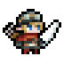 | 0 | **Miya** | Mirkwood Elven Archer | 3 | 1 | 1 | 165.0 | Galadhrim Bow (0.46s CD) and Orthanc Fire bomb |
| 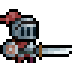 | 1 | **Olaf** | Dwarven Berserker of Erebor | 6 | 1 | 2 | 160.0 | Greataxe of Khazad-dum (0.34s CD) and damage frenzy |
| 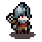 | 2 | **Pyrois** | Knight of the White Tower | 4 | 4 | 1 | 150.0 | Blade of Anduril and Gondor Aegis (0.30s CD) |
| 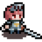 | 3 | **Charlotte** | Dunedain Shadow Ranger | 5 | 0 | 2 | 180.0 | Twin Blades of Narsil (0.28s CD), flurry and dash |
| 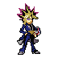 | 4 | **Yugi / Atem** | Pharaoh Summoner | 5 | 1 | 1 | 150.0 | Millennium Puzzle (charge summons, guard, room spells) |
|  | 5 | **Doraemon** | Gadget Cat of the 22nd Century | 5 | 2 | 1 | 150.0 | 4D Pocket (20 gadgets, 6 friend assists, 10 supers) |
| 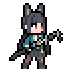 | 6 | **Hoshimi Miyabi** | Frost Swordswoman | 4 | 2 | 1 | 160.0 | Frostbound Blade, dash slash, ice spikes, ice spirit |
| 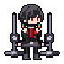 | 7 | **Luong Tho** | Twin Gunblade Duelist | 5 | 2 | 1 | 155.0 | Twin Tonfa-Gunblades, Twin Barrels, White Moon form |

### 3.2 Hero Profiles and Ability Breakdown

#### 0. Miya (Mirkwood Elven Archer)
- **Primary Attack (LMB)**: Fires rapid long-range arrows toward the cursor (0.46s cooldown, 280 px/s projectile speed).
- **Special Skill (Q - Orthanc Fire)**: Throws an alchemical explosive dealing 2x damage plus 1 bonus area damage on detonation (6.5s cooldown).

#### 1. Olaf (Dwarven Berserker of Erebor)
- **Primary Attack (LMB)**: Wide greataxe cleave striking multiple frontline targets (0.34s cooldown).
- **Special Skill (Q - Durin's Wrath)**: Enters battle fury, doubling melee cleave damage (2x) for 5.0 seconds (5.0s cooldown).

#### 2. Pyrois (Knight of the White Tower)
- **Primary Attack (LMB)**: Disciplined sword thrust holding the frontline (0.30s cooldown).
- **Special Skill (Q - Sovereign Rush)**: Charges forward with invulnerability frames, striking targets for +2 bonus damage (5.0s cooldown).

#### 3. Charlotte (Dunedain Shadow Ranger)
- **Primary Attack (LMB)**: Rapid dual-blade strikes with high base mobility and zero armor (0.28s cooldown).
- **Special Skill (Q - Triple Flurry)**: Executes three rapid slashes in place (3.0s cooldown).
- **Secondary Action (RMB - Shadow Step)**: Dashes forward at high speed with invulnerability frames followed by 4 piercing strikes (5.0s cooldown).

#### 4. Yugi / Atem (Pharaoh Summoner)
- **Primary Attack (LMB)**: Directional monster summon (1x damage); hold 0.65s and release for a charged 2x strike.
- **Secondary Action (RMB)**: Targeted-location summon (1x damage); hold 0.65s and release for a charged 3x summon.
- **Guard Stance (Hold Shift)**: Summons a defensive spirit; clicking during guard cancels into a 2x combo summon.
- **Special Skill (Q - Special Summon)**: Casts 1 of 5 room-wide spells at random (Room Blast, Room Laser, Room Lightning, Room Pull, or Room Fire; 12.0s cooldown).

#### 5. Doraemon (Gadget Cat of the 22nd Century)
- **4D Pocket (Mouse Wheel or Z / X + LMB / RMB)**: Cycles through 10 pages containing 20 unique gadgets (Air Cannon, Anywhere Door, Shock Gun, Pencil Missiles, T-Rex Summon, Mini-Doras, and more).
- **Companion Assists (Q below 100 Power)**: Summons 1 of 6 companions in rotation (Nobita, Gian, Shizuka, Dorami, Suneo, Come-come Cat; 8.0s cooldown).
- **Super Moves (Q at >= 100 Power)**: Spends combat-accumulated Power gauge to unleash the active page's Super ability.
- **Dorayaki (F)**: Restores +1 HP (0 Power gained, 20.0s cooldown, limited to 2 uses per floor, resets only on floor transition; does not activate or consume a charge at full HP).

#### 6. Hoshimi Miyabi (Frost Swordswoman)
- **Primary Attack (LMB)**: Three-hit frost blade combo; an accompanying ice spirit automatically fires bolts at nearby visible enemies.
- **Dash Slash (Shift)**: Invulnerable forward slashing dash (1.2s cooldown).
- **Secondary Action (Hold/Release RMB - Frost Wave)**: Charges and launches a frost wave scaling from 1x to 3x damage; full charge freezes enemies (2.0s cooldown).
- **Special Skill (Q - Frost Bloom)**: Drives the blade into the ground to erupt a line of ice spikes dealing 3x damage and freezing foes before shattering (8.0s cooldown).

#### 7. Luong Tho (Twin Gunblade Duelist)
- **Primary Attack (LMB)**: Three-step melee combo (Stab, Twin Swing, and Ground Smash dealing 2x damage with daze).
- **Secondary Action (RMB - Twin Barrels)**: Fires both barrels along the aim line (2 rounds, hold to continue firing; 0.8s cooldown).
- **Special Skill (Q - White Moon)**: Transforms into the white-haired form for 12.0 seconds, granting full damage immunity for the first 2.5 seconds and 30% damage reduction for the remaining 9.5 seconds (valid hits deal at least 1 damage), alongside +1 damage per hit, +25% attack speed, +20% movement speed, and piercing rounds. Base cooldown is 24.0 seconds with a skill-specific 30% Cooldown Reduction cap (minimum 16.8 seconds).

---

## 4. Enemies and Boss Encounters

### 4.1 Standard Enemies

| Portrait | Enemy | Display Name | HP | Armor | Damage | Speed (px/s) | Combat Behavior |
| :---: | :--- | :--- | :---: | :---: | :---: | :---: | :--- |
| 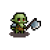 | **Orc** | Moria Orc | 4 | 0 | 2 | 75.0 | Melee vanguard with frontal axe sweeps and flanking AI. |
| 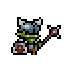 | **Armored Orc** | Armored Uruk-hai | 5 | 6 | 2 (4 enraged) | 75.0 | Heavy melee unit; breaking armor triggers enrage phase. |
| 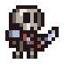 | **Skeleton** | Barrow-wight Remains | 3 | 0 | 1 | 110.0 | High-speed light melee unit that swarms in packs. |
| 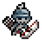 | **Skeleton Archer** | Minas Morgul Bone Archer | 5 | 0 | 2 | 70.0 | Ranged skirmisher that kites players and shoots along clear LoS. |
| 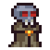 | **Vampire** | Angmar Blood Bat | 5 | 0 | 2 | 85.0 | Agile predator with ranged/close-quarters pressure. |
| 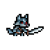 | **Werewolf** | Warg-breed Werewolf | 5 | 0 | 2 (3 pounce) | 95.0 | Fast melee beast with telegraphed leaping pounce attacks. |

### 4.2 Boss Encounters

| Portrait | Boss | Floor Schedule | Base HP | Speed (px/s) | Encounter Mechanics |
| :---: | :--- | :---: | :---: | :---: | :--- |
| 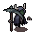 | **Necromancer of Dol Guldur** | Odd floors (1, 5, 7, ...) | 45 | 55.0 | Multi-phase caster firing dark projectiles, raising Skeleton minions, and triggering poison nova columns. |
| 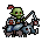 | **Warg Rider Chieftain** | Even floors (2, 4, 8, ...) | 50 | 75.0 | Heavy cavalry chieftain with wide melee cleaves, telegraphed high-speed charges, and spinning strikes. |
|  | **Skeleton King of the Barrow-Downs** | Milestone floors (3, 6, 9, ...) | 60 (+15/tier) | 0.0 (Arena Overlord) | Fixed arena boss protected by Soul Crystals (5 crystals to defeat), sweeping laser volleys, enemy summons, and sub-50% HP enrage. |

---

## 5. Project Directory Structure

```text
Keep-Fighting-And-Earning/
|-- .github/
|   `-- workflows/
|       `-- ci.yml                 # GitHub Actions CI pipeline (30+ headless suites and FPS parity)
|-- Assets/                        # Pixel-art sprites, tilesets, fonts, BGM tracks, and hero SFX
|   |-- Audio/                     # Music tracks and character sound packs
|   |-- Character/                 # Sprite sheets for all 8 heroes, 6 enemies, and 3 bosses
|   |-- Items/                     # Equipment, potion, coin, and icon atlases
|   |-- RpgSkillIcon/              # Pixel and full-resolution Perk icons
|   `-- UI/                        # Shop frames, pixel fonts, portraits, and HUD textures
|-- Menu/                          # Main menu, pause menu, game over, lore, and seed history scenes
|-- Scene/                         # Core gameplay scenes and GDScript modules
|   |-- Balance/                   # Data-driven .tres resources (Heroes/, Enemies/, Bosses/)
|   |-- Character/                 # BasePlayer and individual hero controllers/modules
|   |-- Enemies/                   # BaseEnemy, Tactical AI, standard enemies, and Boss scenes
|   |-- Items/                     # ItemData, ItemDatabase, Inventory, Coin pickups, Loot drops
|   |-- Map/                       # Procedural DungeonGenerator, GuildHall, Traps, Atmosphere
|   |-- Perks/                     # PerkData, PerkDatabase (30 Perks), PerkManager
|   |-- UI/                        # GameUI HUD, PerkSelectionModal, Shop/ (4 merchant UIs)
|   |-- AudioManager.gd            # Music and sound effect manager
|   |-- BalanceConfig.gd           # Centralized stat loader and coin economy table
|   `-- GameManager.gd             # Run state, deterministic seed pipeline, wallet, and replay system
|-- docs/                          # Design specifications, balance audits, benchmarks, and portraits
|   `-- images/                    # Standardized 72x72 RGBA portraits for README documentation
|-- Test/                          # Manual QA matrices and tracking artifacts
|-- tests/                         # Headless Godot automated test scenes and Python test runners
|-- tools/                         # Utility scripts for balance import and asset generation
|-- CHANGELOG.md                   # Version and QA changelog
|-- project.godot                  # Godot Engine 4.7.2 project configuration
|-- run_game.bat                   # Windows launcher script for the game client
|-- run_tests.bat                  # Windows runner for the local automated test suite
`-- world.tscn                     # Primary dungeon scene entry point
```

---

## 6. Automated Test Suite and CI Pipeline

The project maintains comprehensive automated verification across unit tests, property-based invariants, combat regressions, hero verification, merchant economies, replay security, and 30/144 FPS simulation determinism.

### 6.1 Local Test Runner (`run_tests.bat` - 26 Suites)
- **Dungeon Generation & Benchmarks**: `test_dungeon_generator_unit.tscn`, `test_dungeon_properties.tscn` (100 seeds x 5 invariants), `benchmark_dungeon_generator.tscn`
- **Combat, Bosses, & Enemies**: `test_orc_battle.tscn`, `test_skeleton_king.tscn`, `test_werewolf.tscn`, `test_projectile_obstacles.tscn`
- **Playable Heroes & Audio**: `test_doraemon.tscn`, `test_yugi.tscn`, `test_miyabi.tscn`, `test_luong_tho.tscn`, `test_yugi_audio.tscn`, `test_hero_sfx.tscn`
- **Progression, HUD, & Security**: `test_moba_hud_and_inventory.tscn`, `test_perk_system.tscn`, `test_replay_security.tscn`, `test_main_menu_modals.tscn`
- **Guild Hall, Economy, & Shops**: `test_coins.tscn`, `test_guild_hall.tscn`, `test_hall_select.tscn`, `test_rune_portal.tscn`, `test_shop.tscn`, `test_mage_shop.tscn`, `test_potion_shop.tscn`, `test_wallet.tscn`, `test_wandering_merchant.tscn`

### 6.2 Additional CI Verification Suites (`.github/workflows/ci.yml`)
- **Tactical AI & Lifecycle Parity (30 / 144 FPS)**: `test_archer_combat_lifecycle.tscn`, `test_enemy_tactics.gd`, `test_orc_tactical_ai.tscn`, `test_archer_tactical_ai.tscn`, `test_enemy_ai_integration.tscn`, `test_tactical_navigation_contract.tscn`, `test_tactical_base_enemy_integration.tscn`
- **Economy, Balance, & Bug Bash Regressions**: `test_potion_system.tscn`, `test_defensive_combat_balance.tscn`, `test_equipment_loot_perk_balance.tscn`, `test_enemy_floor_balance.tscn`, `test_issue75_development_integration.tscn`, `test_bug_bash_regressions.tscn`, `test_issue75_progression_balance.tscn`, `test_issue75_acceptance.tscn`, `test_issue75_combat_pacing.tscn`, `test_issue75_acquisition.tscn`

---

## 7. Installation and Execution

### 7.1 Prerequisites
- **Godot Engine 4.7.2** (Standard or Console/Headless build on Windows, Linux, or macOS).

### 7.2 Running the Game
Open `project.godot` in Godot Engine 4.7.2 and press `F5`, or launch directly on Windows:
```cmd
run_game.bat
```

### 7.3 Running Automated Tests
Execute the full local verification suite on Windows:
```cmd
run_tests.bat
```
Or run individual test scenes headlessly from the repository root:
```cmd
godot --headless --path . "res://tests/test_luong_tho.tscn"
godot --headless --path . "res://tests/test_doraemon.tscn"
godot --headless --path . "res://tests/test_perk_system.tscn"
godot --headless --path . "res://tests/test_mage_shop.tscn"
godot --headless --path . "res://tests/test_bug_bash_regressions.tscn"
```

---

## 8. Controls

| Input | Action |
| :--- | :--- |
| `W`, `A`, `S`, `D` / Arrow Keys | Move character |
| `Left Mouse Button` | Primary attack / active gadget (Doraemon) |
| `Right Mouse Button` | Secondary skill / secondary gadget (Doraemon) |
| `Q` | Special skill / companion assist or Super (Doraemon) |
| `Shift` | Guard stance (Yugi) / Dash slash (Hoshimi Miyabi) |
| `Mouse Wheel` / `Z` / `X` | Cycle 4D Pocket gadget pages (Doraemon) |
| `F` | Eat Dorayaki (+1 HP, 2 uses per floor, Doraemon) |
| `E` | Interact with NPCs, chests, portals, or ground pickups |
| `1` - `9` | Use or equip hotbar slots |
| `G` / Right-Click Slot | Drop item from inventory |
| `B` / `I` / `Tab` | Open or close Backpack and Equipment panel |
| `M` | Expand or collapse Minimap |
| `N` | Mute or unmute audio |
| `Esc` | Pause menu / close active shop or modal |

---

## 9. Development Team and Contributors

Contributor information below is sourced directly from the repository commit history and pull requests.

| Member | GitHub Handle | Primary Contributions |
| :--- | :--- | :--- |
| **Nguyen Quang Anh** | [@Gumaisme2005](https://github.com/Gumaisme2005) | Project maintainer, core architecture refactoring, procedural dungeon generator, data-driven `BalanceConfig` (`.tres`), Perk system, Inventory/Loot system, Werewolf enemy, performance optimization, and combat fixes |
| **Bui Quang Chien** | [@Bravee9](https://github.com/Bravee9) | Automated testing infrastructure, property-based & bug-bash regression suites, replay security & memory protection, balance tuning, and technical documentation |
| **23001833-cmd** | [@23001833-cmd](https://github.com/23001833-cmd) | Adaptive enemy tactical AI, combat room variants, game balance (Issue #75 progression/economy/combat pacing), tutorial framework, and FPS-parity verification |
| **Pham Duong Hoang** | [@23001880-max](https://github.com/23001880-max) | Playable heroes (Yugi / Atem, Doraemon, Hoshimi Miyabi, Luong Tho), Guild Hall hub, Blacksmith / Mage / Alchemist / Wandering Merchant shops, persistent wallet, Skeleton King boss arena, and hero audio |
| **bao222cld** | [@bao222cld](https://github.com/bao222cld) | Quality assurance, manual playtesting, gameplay bug reporting, combat issue reproduction evidence, and changelog maintenance |

---

## 10. Third-Party Attribution

- **Non-Commercial Fan Content Notice**: Character assets for Yugi / Atem (sprites, audio, voice lines, card names) are non-commercial fan content inspired by *Yu-Gi-Oh!* (Kazuki Takahashi / Konami). Audio clips are adapted from the M.U.G.E.N character "Yami Yugi" (HTDD, after Shiruzato / Mythos); see [`Assets/Audio/Yugi/CREDITS_yugi_audio.txt`](Assets/Audio/Yugi/CREDITS_yugi_audio.txt) for complete credits.
- All third-party sprites, fonts, and audio assets included in `Assets/` remain the property of their respective authors and are used strictly for educational and non-commercial development.
