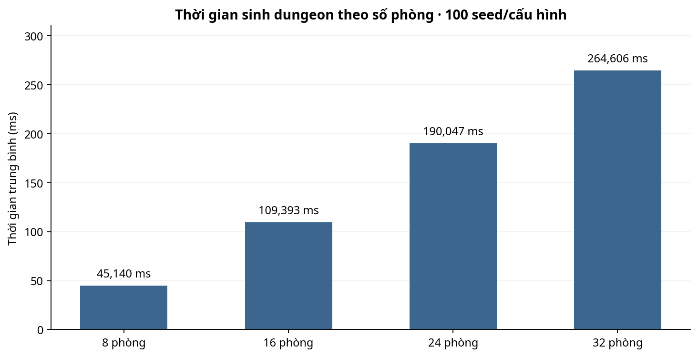
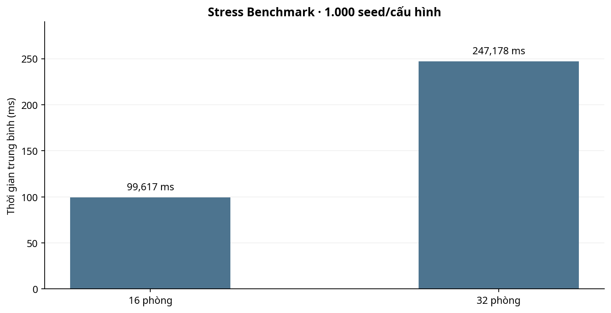
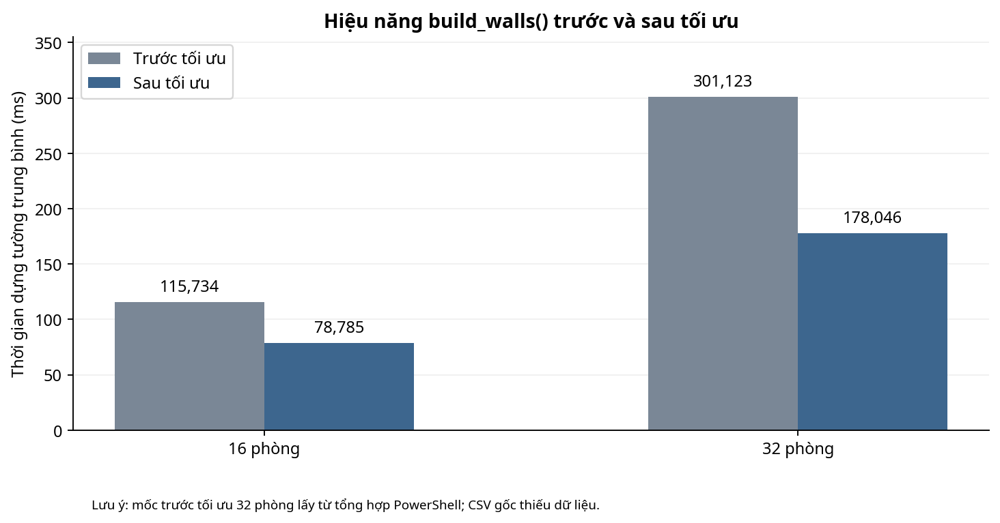

# BÁO CÁO TỔNG KẾT BENCHMARK DUNGEON

**Dự án:** Keep Fighting And Earning  
**Phạm vi:** Benchmark thuật toán sinh dungeon (Godot)  
**Nhánh dự kiến tích hợp:** `feature/dungeon-benchmark`  
**Thời gian thu thập kết quả:** 25–27/10/2026  
**Trạng thái:** Đã tổng hợp dữ liệu từ máy thử nghiệm; **chưa xác nhận trên HEAD mới nhất của `main`**.

## 1. Mục tiêu và phương pháp

Đánh giá thời gian sinh dungeon, độ ổn định khi tăng số phòng, tính hợp lệ của cấu trúc và TileMap, khả năng tái lập theo seed, sau đó xác định điểm nghẽn của `build_walls()` và đo tác động của một cải tiến nhỏ. Benchmark chạy trên **Windows, Godot 4.7.2-stable (official)** qua lệnh `--headless --script`. Tên CPU, RAM và commit Git chưa được cung cấp; cần bổ sung trước khi coi kết quả là phép so sánh giữa các bản phát hành.

Các phép đo thời gian có warm-up theo script. **`total_ms` và các số đo từng giai đoạn có thể lấy từ các lượt sinh dungeon khác nhau**; không cộng số đo giai đoạn thành tổng thời gian rồi coi là cùng một phép đo. Mốc P95 trong báo cáo này tính theo *nearest rank* (`ceil(0,95 × n)`).

## 2. Benchmark theo quy mô (400 lượt)

| Số phòng | Seed | Trung bình (ms) | Nhanh nhất | Chậm nhất | P95 |
|---:|---:|---:|---:|---:|---:|
| 8 | 100 | 45,140 | 37,288 | 88,918 | 58,744 |
| 16 | 100 | 109,393 | 83,576 | 183,153 | 162,758 |
| 24 | 100 | 190,047 | 148,296 | 290,554 | 257,994 |
| 32 | 100 | 264,606 | 213,431 | 389,816 | 330,956 |

Toàn bộ **400/400** lượt được đánh dấu `passed=true` trong CSV. Thời gian trung bình tăng khoảng 5.86 lần khi tăng từ 8 lên 32 phòng.

## 3. Stress benchmark (2.000 lượt)

| Số phòng | Seed | Trung bình (ms) | Trung vị | P95 |
|---:|---:|---:|---:|---:|
| 16 | 1.000 | 99,617 | 96,517 | 121,197 |
| 32 | 1.000 | 247,178 | 233,448 | 315,198 |

Kết quả có **2.000/2.000** lượt `passed=true`, không ghi nhận lỗi kết nối phòng hoặc lỗi tái lập seed theo các điều kiện mà script kiểm tra. Đây không phải kiểm thử gameplay hay FPS.

## 4. Kiểm tra cấu trúc, TileMap và seed

- **200/200** lượt kiểm tra TileMap có `hard_pass=true` (100 seed × 16 phòng; 100 seed × 32 phòng), `collision_status=OK`, `overlap_pairs=0`, `floor_unreachable_rooms=0`. Có **1 lớp vật lý** được phát hiện trong CSV; kiểm tra này là phân tích tĩnh theo TileSet, không phải mô phỏng nhân vật di chuyển.
- File đối chiếu seed sau tối ưu có **200 seed/cấu hình** (100 seed cho mỗi mức phòng) và ghi `generator_sha256 = f49066a36903ab6e3b6867db460b1b6863af7f4792d30ef6cb1d6a1c8c2540c3`, trùng SHA-256 của bản tối ưu được lưu riêng.
- Ba lượt chạy độc lập **trước tối ưu** đã được kiểm tra trên máy người chạy và ảnh PowerShell hiển thị **0 sai khác checksum/số lớp trên 400 phép đối chiếu**. Hiện gói này **chưa có cả 3 CSV nguyên gốc**, nên kết quả đó có bằng chứng là ảnh terminal, không phải phép tái tính đầy đủ từ file đã thu thập ở đây.
- Phép đối chiếu **trước–sau tối ưu** bằng công cụ seed đã báo `0` sai khác hình học/TileMap nhưng đồng thời cảnh báo mã nguồn generator khác nhau — đúng kỳ vọng khi sửa thuật toán, song **không phải xác nhận đạt điều kiện “cùng mã nguồn”**. Trong 118 seed có dòng dữ liệu đầy đủ trước–sau, các trường đếm phòng/tile và trạng thái kết nối đều trùng khớp; phép so sánh này không tương đương kiểm tra SHA-256 của toàn bộ 200 seed hai phiên bản.

## 5. Phân tích `build_walls()` và tối ưu

Điểm nghẽn trong code gốc là kiểm tra ô tường đã thêm bằng `wall_cells.has(neighbor)` trên Array; bản đề xuất dùng `Dictionary` để kiểm tra trùng và vẫn `append()` vào Array theo thứ tự cũ trước khi gọi `set_cells_terrain_connect()`.

| Cấu hình | Trước tối ưu (ms) | Sau tối ưu (ms) | Giảm thời gian |
|---:|---:|---:|---:|
| 16 phòng | 115,734 (100 dòng CSV) | 78,785 (100 dòng CSV) | **31,926%** |
| 32 phòng | 301,123 (100 lượt, tổng hợp PowerShell) | 178,046 (100 dòng CSV) | **40,873%** |

**Giới hạn dữ liệu trước tối ưu:** Tệp `profile_truoc_toi_uu_KHONG_DAY_DU.csv` chỉ có 118 dòng hợp lệ (100 dòng 16 phòng, 18 dòng 32 phòng) và một dòng cuối bị cắt. Không coi tệp đó có đủ 200 mẫu. Với chính **18 seed 32 phòng** đối chiếu trực tiếp, trung bình giảm từ 302,773 ms xuống 176,211 ms, tương ứng **41,801%**. Cần chạy lại trên cùng code/seed sau khi đồng bộ nhánh để củng cố kết luận.

Các kết quả cho thấy phương án tối ưu có tiềm năng đáng kể, nhất là ở dungeon lớn. Tuy nhiên, chênh lệch giữa các đợt đo có thể chịu ảnh hưởng từ tải hệ thống và chưa có đầy đủ môi trường, SHA commit tương ứng.

## 6. Phát hiện và giới hạn khác

- **Vùng cấm trang trí xung quanh bẫy:** bình luận trong generator mô tả 5×5 nhưng hai vòng `range(-2, 2)` chỉ đi qua 4 tọa độ mỗi chiều. Đây là vấn đề tách biệt, **chưa sửa trong bản so sánh** để không làm thay đổi kết quả bố cục giữa trước và sau tối ưu.
- `layer_2_cells=0` trong dữ liệu kiểm tra TileMap. Không thể coi đây là lỗi nếu lớp 2 vốn để trống trong thiết kế.
- Không đo bộ nhớ đỉnh, FPS, va chạm động, khả năng chơi thực tế, hoặc so sánh máy khác. **Không khẳng định đã kiểm tra các nội dung này**.

## 7. Kết luận và điều kiện tích hợp vào `main`

**Kết luận kỹ thuật:** Các phép benchmark hiện có không ghi nhận lỗi theo bộ điều kiện của script; `build_walls()` là điểm tối ưu có số liệu hỗ trợ. Đề nghị giữ phương án dùng Dictionary nếu vượt qua kiểm tra lại trên code cuối của nhóm.

**Chưa hoàn tất điều kiện merge:**

1. Đối chiếu commit/nhánh `feature/dungeon-benchmark` với `main` mới nhất; giải quyết xung đột và chỉ áp dụng bản vá tường vào generator đã được nhóm cập nhật.
2. Chạy lại 100 seed cho 16/32 phòng trên code tích hợp; kiểm tra hiệu năng và tính hợp lệ.
3. Lưu cả CSV của **3 phiên seed replay trên một mã nguồn thống nhất**, kiểm tra lại SHA-256 trong từng phiên; bổ sung thông tin CPU/RAM và commit được đo.
4. Rà soát Pull Request, không tự merge khi chưa xác nhận những nội dung trên.

**Nguồn dữ liệu:** CSV gốc lưu ở `benchmark/results/` và `benchmark/advanced/results/`; xem `benchmark/README.md` để biết vị trí chính xác và lệnh chạy.
