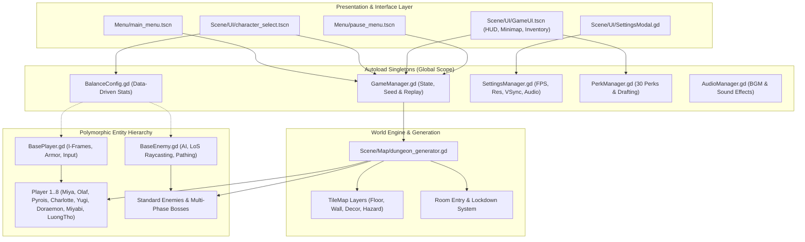
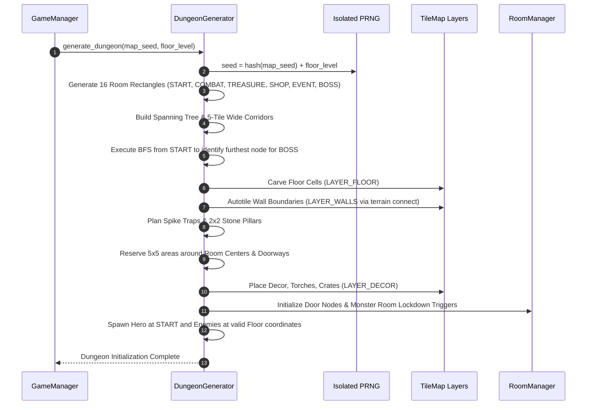

# SYSTEM ARCHITECTURE AND CODEBASE DESIGN

**Project:** Keep Fighting And Earning  
**Engine:** Godot Engine 4.7.2 (GDScript 2.0)  
**Architecture Pattern:** Component-Based Entity Model with Centralized Autoload Singletons and Data-Driven Custom Resources  

---

## 1. High-Level Architectural Topology

The software architecture is divided into decoupled modular layers: Presentation & User Interface, Game State & Persistence, Procedural Generation & World Engine, Entity Inheritance Model, and Centralized Balance Configuration.



---

## 2. Autoload Singletons and State Management

### 2.1 `GameManager.gd` (`/root/GameManager`)
The central coordinator for session lifecycle, seed generation, progression tracking, and replay recording:
- **Seed Management:** Provides `set_seed()`, `generate_random_seed()`, and `sanitize_seed()` (regex whitelist `[A-Za-z0-9_-]` capped at 32 characters).
- **Run State Tracking:** Records `current_seed`, `current_level` (dungeon floor), `enemies_killed`, and `selected_character_index`.
- **Replay Engine:** Records 60Hz player input frames into a ring buffer. Manages persistent storage in `user://roguelike_save_data.json` with strict 10-replay FIFO limits, 3,600 frame bounding, and 2 MB disk quotas.
- **Scene Routing:** Orchestrates clean scene transitions between Main Menu, Character Select, and the primary Dungeon Game world.

### 2.2 `BalanceConfig.gd` (`/root/BalanceConfig`)
The single source of truth for combat and unit statistics across the entire project:
- **Resource Pipeline:** Loads and caches `.tres` resources from `Scene/Balance/Heroes/`, `Scene/Balance/Enemies/`, and `Scene/Balance/Bosses/`.
- **Dynamic Accessors:** Exposes `get_hero_stat(hero_id, stat_key)` and `set_unit_stat(category, unit_id, stat_key, value)`.
- **Automatic Syncing:** Character instantiation scripts read directly from `BalanceConfig`, eliminating hard-coded values in individual entity scripts.

### 2.3 `SettingsManager.gd` (`/root/SettingsManager`)
Hardware synchronization and user preference persistence:
- **FPS Throttling:** Directly modulates `Engine.max_fps` (presets: 30, 60, 120, 144, unlimited, and custom 20 to 360).
- **Resolution Control:** Interfaces with `DisplayServer` to resize viewports across 6 discrete presets (720p to 4K).
- **Display Modes:** Supports Windowed, Borderless Fullscreen, and Exclusive Fullscreen (`DisplayServer.WINDOW_MODE_EXCLUSIVE_FULLSCREEN`).
- **Persistence Engine:** Automatically commits and restores settings from `user://settings.cfg` via Godot's `ConfigFile` API.

### 2.4 `PerkManager.gd` (`/root/PerkManager`)
Roguelike meta-progression and perk drafting:
- Maintains a registry of 30 perks distributed across Common, Rare, Epic, and Legendary tiers.
- Emits random 3-perk draft offerings upon clearing floor bosses or interacting with dungeon shrines.
- Applies mathematical hooks to damage formulas, attack speed multipliers, movement speed, and revival mechanics.

### 2.5 `AudioManager.gd` (`/root/AudioManager`)
Centralized audio playback:
- Routes background music tracks and positional sound effects through dedicated Audio Buses (`Master`, `BGM`, `SFX`).
- Dynamically converts linear volume percentages (0.0 to 1.0) into logarithmic decibel values (-30 dB to 0 dB, -80 dB on mute).

---

## 3. Polymorphic Entity Hierarchy

To enforce software reusability and eliminate code duplication, combat entities inherit from specialized base controllers:

```
Node2D
└── CharacterBody2D
    ├── BasePlayer.gd
    │   ├── Player 1 (Miya) - Archer
    │   ├── Player 2 (Olaf) - Berserker
    │   ├── Player 3 (Pyrois) - Knight
    │   ├── Player 4 (Charlotte) - Ranger
    │   ├── Player 5 (Yugi / Atem) - Summoner
    │   ├── Player 6 (Doraemon) - Gadget Specialist
    │   ├── Player 7 (Hoshimi Miyabi) - Frost Swordswoman
    │   └── Player 8 (Luong Tho) - Gunblade Duelist
    │
    └── BaseEnemy.gd
        ├── Orc
        ├── Armored Orc
        ├── Skeleton
        ├── Skeleton Archer
        ├── Vampire
        ├── Werewolf
        ├── Boss: Necromancer
        ├── Boss: Orc Rider
        └── Boss: Skeleton King
```

### 3.1 `BasePlayer.gd`
- **Core State:** Manages `current_health`, `max_health`, `current_armor`, `max_armor`, `base_damage`, and `base_speed`.
- **Armor Regeneration:** Tracks an out-of-combat timer. After 5.0 seconds without taking damage, armor automatically regenerates at 1 point per 0.5 seconds up to `max_armor`.
- **Invulnerability & Hurtbox:** Handles `is_invulnerable` state flags, periodic sprite flashing via tweens, and safe cleanup upon node deletion.
- **Input & Aiming:** Calculates real-time 360-degree aiming angles toward the cursor position.

### 3.2 `BaseEnemy.gd`
- **AI State Machine:** Implements `IDLE`, `PATROL`, `CHASE`, `ATTACK`, and `DEAD` states.
- **Line-of-Sight Raycasting:** Casts 2D physics rays against environmental tile collision layers to verify clear line-of-sight before initiating attacks.
- **Combat Resolution:** Handles damage reception, hurt flash tweens, knockback impulses, and loot drop triggers upon defeat.

---

## 4. Procedural Generation Pipeline

The generation process executes deterministically in linear phases:



### Key Technical Safeguards:
1. **Pillar Footprint Verification:** 2x2 stone pillars are checked against floor boundaries and reserved regions to prevent blocking room passages.
2. **Safe Entity Spawning:** `is_valid_entity_spawn_cell()` ensures entities only spawn on clear floor tiles, strictly avoiding spike traps, pillars, and solid wooden crates.
3. **Collision Path Guarantees:** Flood-fill algorithms verify continuous connectivity between all rooms and the start room before the generation phase completes.

---

## 5. UI Architecture and Input Hierarchy

### 5.1 Click-Through Protection and Modal Dimming
To prevent unintentional player attacks or movement while menus are open:
- All overlay dialogs (`SettingsModal`, `GuideModal`, `InventoryModal`) include full-screen `ColorRect` backdrops with `mouse_filter = MOUSE_FILTER_STOP`.
- When an overlay is displayed, background mouse clicks and key inputs are consumed by the backdrop.

### 5.2 Responsive Text Layout in ScrollContainers
In Godot 4, labels with `autowrap_mode` inside a `ScrollContainer` can collapse to single-character columns unless constrained:
- The UI framework sets explicit `custom_minimum_size` on inner `VBoxContainer` elements.
- Connects to the `resized` signal of `ScrollContainer` to dynamically bind content width to `maxf(400.0, scroll.size.x - scrollbar_width - 12.0)`.

### 5.3 Strict Modal Stacking Order
- Pressing `Escape` queries modals in descending priority: `SettingsModal` -> `GuideModal` -> `InventoryModal`.
- Only when all sub-modals are dismissed does pressing `Escape` pause or unpause the game.
- The pause menu card is hidden whenever a sub-modal is opened, eliminating visual bleed-through.

---

## 6. Security and Memory Protection Architecture

The codebase incorporates defense-in-depth measures against memory exhaustion and malicious input:

1. **Input Sanitization (SEC-01):** Whitelist filtering on all seed strings prevents command injection and path traversal exploits.
2. **Save File Bounding (SEC-02):** Enforces a strict 2 MB maximum ceiling on `user://roguelike_save_data.json` before reading into memory.
3. **Replay Frame Sanitization (SEC-03):** Validates all float coordinates using `is_finite()`, rejects `NaN` / `INF` values, clamps vectors, and bounds array capacity to 3,600 frames.
4. **FIFO Memory Deallocation:** Automatically purges detailed frame buffers for runs exceeding the 10-replay threshold, preserving system stability.
