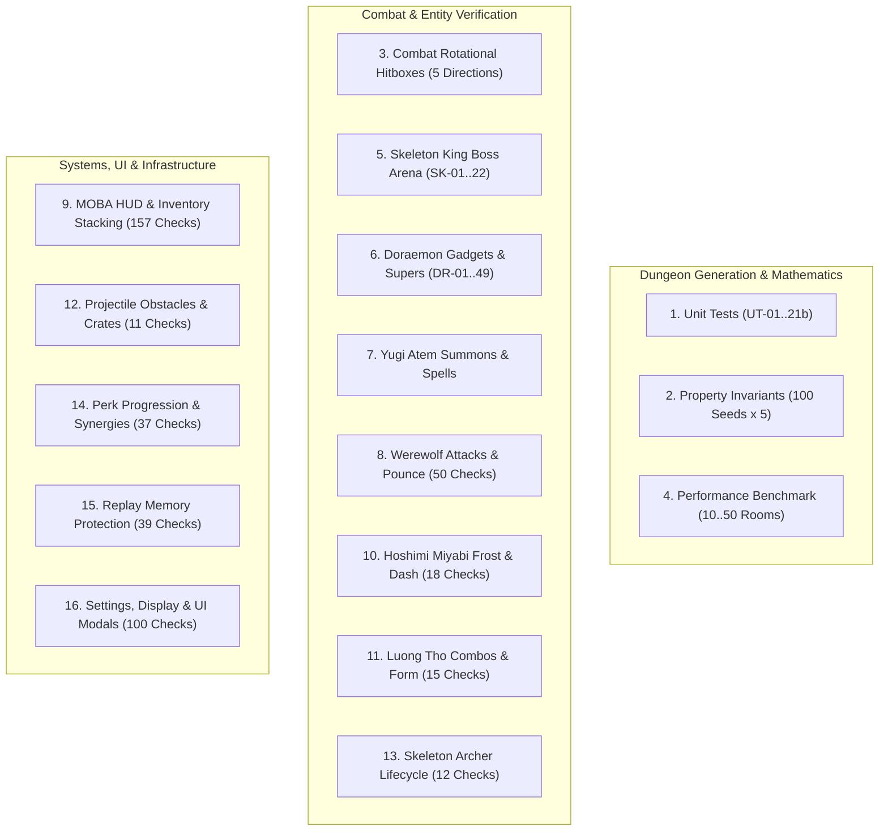

# AUTOMATED TEST SUITE AND QUALITY ASSURANCE CATALOG

**Project:** Keep Fighting And Earning  
**Engine:** Godot Engine 4.7.2 (Headless Console CLI)  
**Execution Script:** `run_tests.bat`  
**CI/CD Pipeline:** `.github/workflows/ci.yml`  
**Overall Status:** 16 Suites | 100% Passed | 0 Failures  

---

## 1. Overview and Quality Assurance Strategy

The project employs an automated verification pipeline designed for headless continuous integration. All gameplay mechanics, structural generation algorithms, data-driven balance configurations, physics raycasting boundaries, and memory protection systems are verified across 16 specialized test suites:



---

## 2. Test Suite Breakdown and Verification Matrix

### Suite 1: Dungeon Generator Unit Tests
- **Scene:** `tests/test_dungeon_generator_unit.tscn`
- **Scope:** 28 unit assertions covering room bounds, boss placement distance, minimal spanning tree connectivity, trap distribution, hero basic attacks, LoS wall blocking, dynamic balance sync, and variant metadata.
- **Key Assertions:** `UT-01` through `UT-21b`.
- **Command:**
  ```powershell
  godot --headless --path . "res://tests/test_dungeon_generator_unit.tscn"
  ```

### Suite 2: Property-Based Invariant Tests
- **Scene:** `tests/test_dungeon_properties.tscn`
- **Scope:** Property testing across 100 randomly sampled seeds and 5 core structural invariants (500 checks total):
  1. `PROP-01` (Determinism): `generate(seed) == generate(seed)`.
  2. `PROP-02` (Graph Connectivity): Every room reachable from the start room via BFS.
  3. `PROP-03` (Grid Flood-Fill Walkability): Zero isolated floor pockets across TileMap layers.
  4. `PROP-04` (Boss Optimality): Boss room positioned at maximum shortest-path distance.
  5. `PROP-05` (Safe Spawns): Zero entities, obstacles, or chests spawned on spike traps or pillars.
- **Command:**
  ```powershell
  godot --headless --path . "res://tests/test_dungeon_properties.tscn"
  ```

### Suite 3: Combat Rotational Hitbox Tests
- **Scene:** `tests/test_orc_battle.tscn`
- **Scope:** 5 assertions verifying 360-degree rotational accuracy across cardinal and diagonal attack vectors (East, South, West, North, North-East).
- **Command:**
  ```powershell
  godot --headless --path . "res://tests/test_orc_battle.tscn"
  ```

### Suite 4: Dungeon Generator Performance Benchmark
- **Scene:** `tests/benchmark_dungeon_generator.tscn`
- **Scope:** Measures execution time across 10, 16, 25, 36, and 50 room configurations over 25 iterations each.
- **Reference Metric:** 16 rooms (default) generates in average `130.16 ms` (P50: `130.07 ms`, P95: `136.74 ms`).
- **Command:**
  ```powershell
  godot --headless --path . "res://tests/benchmark_dungeon_generator.tscn"
  ```

### Suite 5: Skeleton King Boss Arena Tests
- **Scene:** `tests/test_skeleton_king.tscn`
- **Scope:** 22 assertions validating Soul Crystal invulnerability shielding, rotating laser grid cycles, enrage phases at 50% HP, minion summons, and arena unlock transitions (`SK-01`..`SK-22`).
- **Command:**
  ```powershell
  godot --headless --path . "res://tests/test_skeleton_king.tscn"
  ```

### Suite 6: Doraemon Hero Verification Tests
- **Scene:** `tests/test_doraemon.tscn`
- **Scope:** 49 assertions validating the 4D Pocket (10 pages, 20 gadgets), mouse wheel pagination, 6 companion assists (Nobita, Gian, Shizuka, Dorami, Suneo, Come-come Cat), 10 super abilities, crate collision blocking, and power gauge accumulation (`DR-01`..`DR-49`).
- **Command:**
  ```powershell
  godot --headless --path . "res://tests/test_doraemon.tscn"
  ```

### Suite 7: Yugi Atem Hero Verification Tests
- **Scene:** `tests/test_yugi.tscn`
- **Scope:** Directional monster strikes, charged attacks (0.65s hold for 2x/3x damage), Guard Spirit stance (Shift), and 5 room-wide spell algorithms (Blast, Laser, Lightning, Pull, Fire).
- **Command:**
  ```powershell
  godot --headless --path . "res://tests/test_yugi.tscn"
  ```

### Suite 8: Werewolf Functional and Integration Tests
- **Scene:** `tests/test_werewolf.tscn`
- **Scope:** 50 assertions validating close-range claw attacks, wind-up telegraphs, red trajectory warnings, damage interruptions, 95px pounce distance bounding, and death lifecycles.
- **Command:**
  ```powershell
  godot --headless --path . "res://tests/test_werewolf.tscn"
  ```

### Suite 9: MOBA HUD, Stacking and Equipment Tests
- **Scene:** `tests/test_moba_hud_and_inventory.tscn`
- **Scope:** 157 assertions covering numeric health and armor progress bars, Minecraft-style potion stacking up to 16 units, stack decrementing, world item dropping, equipment stat calculation, and drag-and-drop mechanics.
- **Command:**
  ```powershell
  godot --headless --path . "res://tests/test_moba_hud_and_inventory.tscn"
  ```

### Suite 10: Hoshimi Miyabi Hero Tests
- **Scene:** `tests/test_miyabi.tscn`
- **Scope:** 18 assertions validating 3-hit frost combo, invulnerable dash slash, charged Frost Wave, Frost Bloom eruption, and autonomous ice spirit targeting AI.
- **Command:**
  ```powershell
  godot --headless --path . "res://tests/test_miyabi.tscn"
  ```

### Suite 11: Luong Tho Hero Tests
- **Scene:** `tests/test_luong_tho.tscn`
- **Scope:** 15 assertions validating 3-step weapon sequence (Stab -> Twin Swing -> Ground Smash), Twin Barrels firing along cursor angle, White Moon transformation, piercing rounds, and invulnerability.
- **Command:**
  ```powershell
  godot --headless --path . "res://tests/test_luong_tho.tscn"
  ```

### Suite 12: Projectile Obstacle Regression Tests
- **Scene:** `tests/test_projectile_obstacles.tscn`
- **Scope:** 11 assertions validating that solid wooden crates obstruct fast projectiles, ricochets bounce correctly, shots cannot initiate inside obstacles, and non-solid decorations remain transparent to combat.
- **Command:**
  ```powershell
  godot --headless --path . "res://tests/test_projectile_obstacles.tscn"
  ```

### Suite 13: Skeleton Archer Combat Lifecycle Tests
- **Scene:** `tests/test_archer_combat_lifecycle.tscn`
- **Scope:** 12 assertions testing Archer AI kiting, maintaining 85px standoff distance, wall navigation, arrow flight trajectories, and safe node freeing.
- **Command:**
  ```powershell
  godot --headless --path . "res://tests/test_archer_combat_lifecycle.tscn"
  ```

### Suite 14: Perk Progression System Tests
- **Scene:** `tests/test_perk_system.tscn`
- **Scope:** 37 assertions testing 30 perks across 4 rarity tiers (Common, Rare, Epic, Legendary), deterministic drafting, unique perk deduplication, combat hook calculations, and second-chance revivals.
- **Command:**
  ```powershell
  godot --headless --path . "res://tests/test_perk_system.tscn"
  ```

### Suite 15: Replay Security and Memory Protection Tests
- **Scene:** `tests/test_replay_security.tscn`
- **Scope:** 39 assertions validating the 10-replay FIFO hard cap, memory deallocation of stale frames, manual replay deletion, 3,600 frame bounding, stationary idle compression, and the 2 MB save file limit.
- **Command:**
  ```powershell
  godot --headless --path . "res://tests/test_replay_security.tscn"
  ```

### Suite 16: Settings, Graphics and UI Integration Tests
- **Scene:** `tests/test_settings_and_ui.tscn`
- **Scope:** 100 assertions validating FPS modes (30, 60, 120, 144, unlimited, custom 20..360), 6 resolution presets, window modes, VSync, audio volume and mute controls, `user://settings.cfg` persistence, click-blocking backdrops, character dossier fixed scroll box without overflow, and pause menu button bleed-through prevention.
- **Command:**
  ```powershell
  godot --headless --path . "res://tests/test_settings_and_ui.tscn"
  ```

---

## 3. Running All Tests Locally

To execute the entire 16-suite automated test suite sequentially on Windows:
```cmd
run_tests.bat
```

For continuous integration environments (Linux / Docker):
```bash
docker compose run --rm test
```
