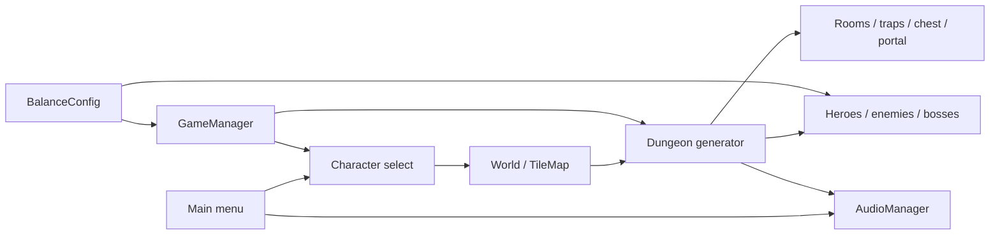

# Cấu trúc dự án

Thư mục chứa `project.godot` là gốc dự án. Workspace ZIP hiện có thêm một thư mục
bao ngoài cùng tên; mở thư mục chứa `project.godot` trong Godot/IDE.

Cây này đã được tích hợp vào branch `chore/project-structure-v2` từ `777d9d9`.
Giữ roster 6 hero và chức năng mới của repository; xem
[báo cáo tích hợp](INTEGRATION_REPORT.md). Các audit ZIP bên cạnh là snapshot
4 hero trước tích hợp, không phải kết quả của branch hiện tại.

```text
Keep-Fighting-And-Earning/
├── Assets/                       # Gói ảnh, font, audio hiện có; giữ nguyên tên
├── scenes/                       # Scene + script liên quan đặt cạnh nhau
│   ├── main/world.tscn            # TileMap, nền, pause và game-over
│   ├── menus/                    # main_menu/, pause_menu/, game_over_menu/
│   ├── characters/               # pyrois/, olaf/, miya/, charlotte/, yugi/, doraemon/
│   ├── enemies/                  # 6 loại quái (gồm werewolf/) và 3 boss
│   ├── dungeon/                  # Generator, atmosphere, room, portal, trap
│   ├── items/                    # ItemData, .tres, chest/, world_item/
│   ├── projectiles/              # Arrow, bomb, magic, poison
│   └── ui/                       # HUD, chọn nhân vật, inventory slot, theme
├── scripts/
│   ├── core/                     # GameManager, AudioManager, BalanceConfig
│   └── review/review_service.gd   # VT-075, độc lập với scene gameplay
├── tests/                        # Unit, property, combat, mechanics, backdrop
│   └── vt075/                    # Harness, load test, coverage/mutation tools
├── benchmarks/
│   ├── benchmark.tscn            # Runner 100 seed đã có từ trước
│   ├── dungeon_benchmark.gd
│   ├── benchmark_dungeon_generator.{gd,tscn} # 5 quy mô × 25 lượt
│   ├── scalability/              # 8/16/24/32 phòng × 100 seed
│   ├── advanced/                 # Stress, profiling, TileMap, seed replay
│   │   └── results/              # CSV chuyên sâu và dữ liệu chưa đầy đủ
│   ├── results/                  # CSV/log cơ bản và kết quả scalability
│   └── reports/                  # Báo cáo và biểu đồ lịch sử
├── docs/
│   ├── gameplay/                 # GDD, balance workflow, fog/trap/difficulty
│   ├── qa/                       # Test plan, seed issues, testcase và lịch sử QA
│   ├── architecture/             # Cấu trúc, manifest, báo cáo và bằng chứng
│   ├── DEVELOPMENT_ROADMAP.md
│   ├── FEATURE_CHECKLIST.md       # Phạm vi chức năng và mức độ kiểm chứng
│   ├── PROJECT_STATUS.md          # Tóm tắt, bằng chứng, gate release, quy trình cập nhật
│   └── DEVELOPMENT_BACKLOG.md     # Lỗi/việc có ID, ưu tiên, tiêu chí đóng
├── tools/                        # Kiểm tra tham chiếu và runner PowerShell
├── .github/                      # CI, issue template, PR template
├── .agent/workflows/             # Quy trình cân bằng sẵn có
├── project.godot
├── export_presets.cfg
├── run_game.bat, run_tests.bat
├── README.md, CONTRIBUTING.md, CHANGELOG.md
└── .gitignore, .gitattributes, .editorconfig, .dockerignore
```

## Ranh giới và phụ thuộc



Mũi tên thể hiện luồng scene hoặc dữ liệu/lệnh giữa các module đã có; không thêm
service, networking hay tầng kiến trúc mới. ReviewService VT-075 là module offline
độc lập, được kiểm thử riêng qua dữ liệu lịch sử run.

- `scripts/core/game_manager.gd` và `audio_manager.gd` là autoload; giữ tên singleton
  `GameManager`/`AudioManager`. `BalanceConfig` là script dùng chung, không thêm autoload mới.
- Main scene là `scenes/menus/main_menu/main_menu.tscn`, tiếp theo chọn nhân vật và
  `scenes/main/world.tscn`. Các node path, signal, UID và class_name giữ nguyên.
- Các hero kế thừa `scenes/characters/pyrois/player.gd`; inventory/HUD và scene
  projectile vẫn được nối qua `ext_resource`, `extends`, `preload` hoặc `load`.
- Dungeon dùng RNG riêng từ seed và tầng, sau đó quy hoạch phòng, bẫy, trang trí,
  quái và loot. Tái cấu trúc chỉ thay đường dẫn; không đổi thứ tự gọi RNG, thuật toán,
  kích thước phòng, số seed hoặc thông số đo.
- Các runner benchmark có mục tiêu/định dạng khác nhau nên giữ toàn bộ, không gộp
  thành một phép đo mới. Runner 100 seed tạo `basic_<timestamp>_<pid>.csv/.log`
  trong `benchmarks/results/`, có suffix nếu trùng tên. `results.csv` và
  `benchmark_log.txt` cũ là dữ liệu lịch sử được giữ nguyên. Runner scalability/
  advanced vẫn dùng cách lưu có timestamp như trước.
- `docs/`, `tools/` và các thư mục kết quả/báo cáo có `.gdignore`. Không đặt tài
  nguyên runtime trong đó; không đặt `.gdignore` ở gốc `benchmarks/` hay `tests/`.

## Quy ước

Tên mới dùng `snake_case`. Giữ scene và script của cùng thực thể cạnh nhau thay vì
chia thành hai cây song song. `Assets/` là ngoại lệ cho các gói hiện có để tránh
đổi tên hàng trăm tài nguyên chỉ vì hình thức. Không thêm thư mục audio/enemies
rỗng hoặc lớp kiến trúc chưa có nhu cầu thực tế.

`Test/` cũ chứa QA thủ công nên chuyển vào `docs/qa/`; `tests/` giữ mã kiểm thử tự
động. Cách này cũng loại bỏ tên thư mục chỉ khác hoa/thường giữa Windows và Linux.

## Di chuyển và review

Chạy `python tools/check_project_structure.py` để kiểm tra đường dẫn đúng hoa/thường,
UID trùng/mất, UID sidecar, `ext_resource` và `sub_resource`. Công cụ này không biên
dịch GDScript và không chứng minh game chạy đúng; vẫn cần import, test và chơi thử.

Xem [báo cáo tái cấu trúc](RESTRUCTURE_REPORT.md), [danh sách thay đổi](FILES_CHANGED.md)
và [manifest SHA-256](refactor_manifest.json) để đối chiếu với bản ZIP ban đầu.

Trạng thái mới nhất nằm trong [master audit](MASTER_AUDIT.md) và [mục lục docs](../README.md).
Các báo cáo/inventory cũ được giữ là snapshot tại thời điểm đã chạy.

Tham khảo chính thức: [Godot project organization](https://docs.godotengine.org/en/4.7/tutorials/best_practices/project_organization.html)
và [resource UID sidecars](https://godotengine.org/article/uid-changes-coming-to-godot-4-4/).
